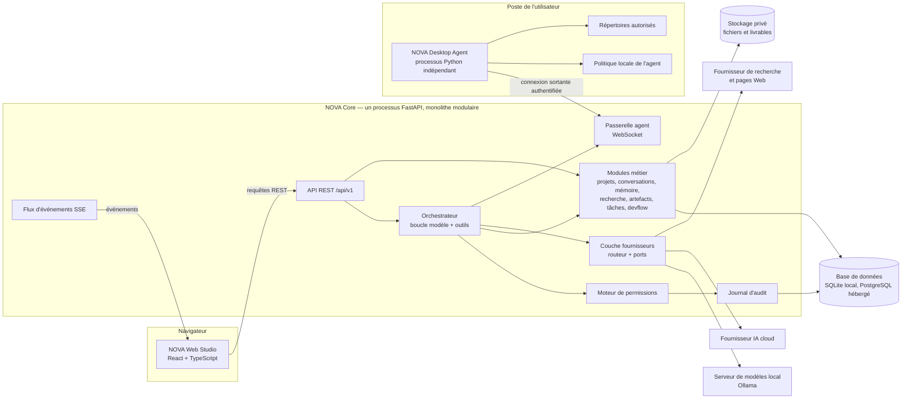
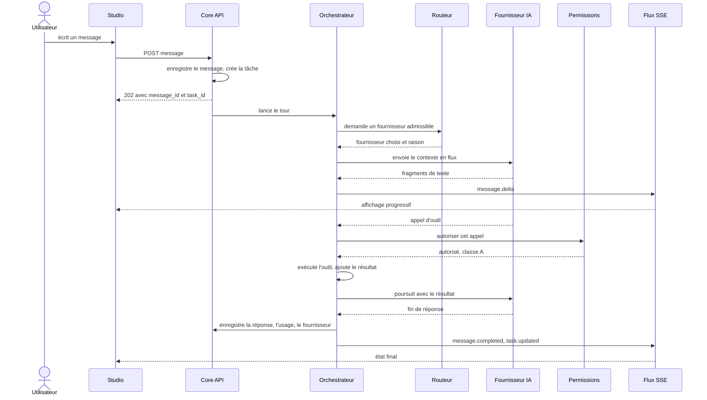
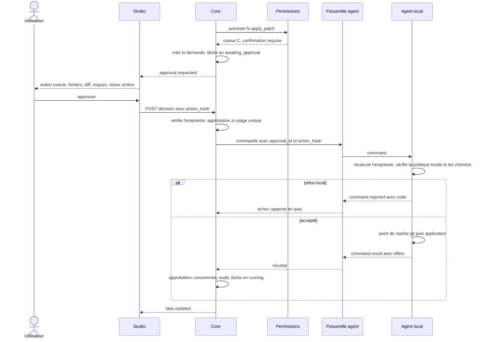

# 02 — Architecture

Statut : validé le 2026-10-09

## 1. Vue d'ensemble

Trois processus, une seule base de données, aucun port ouvert sur l'agent.

Lecture du schéma :

- **Le Studio ne parle qu'au Core.** Il ne détient aucun secret et n'appelle jamais un fournisseur IA directement.
- **Le modèle ne décide de rien d'exécutoire.** Il émet des appels d'outils structurés ; le moteur de permissions, en code, autorise, demande confirmation ou refuse.
- **L'agent initie la connexion.** Il n'écoute sur aucun port. Il applique sa propre politique, stockée localement, que ni le Core ni le modèle ne peuvent élargir.

## 2. Les trois composants

### 2.1 NOVA Web Studio

Application monopage React. Elle affiche la conversation, le canvas, les tâches, les versions et les demandes d'autorisation. L'état serveur vient de l'API REST et se tient à jour par un flux d'événements unique. Détail des dossiers : [03](03-modules.md) §5.

### 2.2 NOVA Core

Un seul processus Python (FastAPI). Les modules sont des paquets internes aux frontières explicites : chaque module expose une interface de service et ne lit jamais les tables d'un autre. Les tâches longues s'exécutent dans le même processus, en tâches asynchrones, avec leur état persisté en base. Détail : [03](03-modules.md) §3.

### 2.3 NOVA Desktop Agent

Processus Python séparé, lancé par l'utilisateur. Il exécute un petit jeu d'actions déterministes (fichiers, commandes prédéfinies, git) dans des répertoires que l'utilisateur a explicitement autorisés. Détail du protocole : [06](06-protocole-agent.md).

## 3. Flux d'exécution

### 3.1 Un tour de conversation

La réponse ne dépend pas de l'onglet : si le navigateur se ferme, le tour continue et son résultat est retrouvé à la reconnexion (rejeu des événements depuis le dernier identifiant reçu).

### 3.2 Une action sensible exécutée par l'agent

Deux vérifications indépendantes protègent chaque action : celle du Core, puis celle de l'agent. Une erreur ou une compromission d'un côté ne suffit pas.

## 4. Décisions d'architecture

Chaque décision est proposée ; elle devient contraignante une fois la Phase 0 validée.

| # | Décision | Justification | Alternative écartée |
| --- | --- | --- | --- |
| ADR-01 | Monolithe modulaire ; tâches longues en tâches asynchrones dans le processus ; pas de file de messages au MVP | Un seul utilisateur, un seul poste. Une file (Redis, Celery) ajouterait un service à installer et à surveiller sans bénéfice. Le port `TaskRunner` permet de la brancher plus tard | Microservices ; file externe |
| ADR-02 | Cible du MVP : un utilisateur, exécution locale ; architecture compatible avec un hébergement | Assistant personnel, confidentialité, coût nul d'hébergement. Hypothèses H1 et H2 à valider | Service hébergé multi-utilisateur dès le MVP |
| ADR-03 | Core vers Studio : flux SSE unique et rejouable. Studio vers Core : REST. WebSocket réservé à la liaison Core–agent | Le Studio n'a besoin que de recevoir ; SSE se reconnecte seul et rejoue depuis le dernier événement. L'agent, lui, a besoin d'un canal bidirectionnel | WebSocket partout |
| ADR-04 | Boucle d'orchestration écrite pour NOVA, avec un registre d'outils ; pas de framework d'agents | Les points de contrôle (permissions, audit, annulation, contamination) doivent se trouver à des endroits précis de la boucle. Un framework les masque et lie le projet à ses abstractions | Framework d'agents générique ; classifieur d'intention suivi de pipelines fixes |
| ADR-05 | Ports par capacité (`ChatProvider`, `SearchProvider`, `ImageProvider`, parole) et routeur déterministe à contraintes dures | Exigence d'indépendance vis-à-vis du fournisseur. Les règles de confidentialité ne peuvent pas dépendre d'un jugement du modèle | Appels directs à un SDK dans la logique métier |
| ADR-06 | Le canvas est une scène d'artefacts typés avec moteurs de rendu enfichables | Tous les contenus exigés (rapport, maquette, 3D, diff) sont des documents à part entière, pas des formes sur un tableau. Le positionnement libre n'est exigé nulle part | Tableau blanc infini |
| ADR-07 | Wireframes, maquettes et aperçus d'application sont du HTML autonome rendu dans un cadre isolé (`sandbox`, sans `allow-same-origin`, sans réseau) | Aperçu réellement interactif sans service de génération d'images ; le source est directement réutilisable pour l'implémentation | Images statiques générées |
| ADR-08 | Versions immuables dès qu'elles quittent le brouillon ; une validation référence une version et son empreinte | Exigence : une validation concerne une version précise | État porté par l'artefact |
| ADR-09 | Permissions appliquées en code à deux points, Core et agent ; jamais par le modèle | Un texte venu d'une page Web ou d'un fichier ne doit pas pouvoir changer une permission | Consignes dans le prompt |
| ADR-10 | Agent : connexion sortante, authentification mutuelle par clés Ed25519, commandes désignées par identifiant (l'agent construit lui-même la ligne d'arguments) | Aucun port local exposé ; aucune chaîne produite par le modèle n'atteint un interpréteur de commandes | Serveur HTTP local sur l'agent ; exécution de chaînes shell |
| ADR-11 | SQLAlchemy 2 et Alembic ; SQLite en local, PostgreSQL en hébergé ; colonnes JSON génériques | Conforme au cahier des charges ; un seul modèle pour les deux moteurs | Deux schémas distincts |
| ADR-12 | Contrat unique : OpenAPI généré par le Core, types TypeScript générés ; protocole agent décrit par des modèles Pydantic partagés | Supprime les divergences entre le Studio, le Core et l'agent | Types écrits à la main de chaque côté |
| ADR-13 | Historique de conversation en ajout seul ; la charge utile brute du fournisseur est conservée à côté du message normalisé | Plusieurs fournisseurs exigent de renvoyer certains blocs à l'identique (blocs de raisonnement de Claude, par exemple) et invalident un historique modifié | Réécriture ou résumé destructif de l'historique |
| ADR-14 | Mémoire sans embeddings au MVP : décisions confirmées, éléments épinglés et correspondance par mots-clés | Quelques dizaines à centaines d'éléments par projet ; un fournisseur d'embeddings est une dépendance de plus | Base vectorielle |
| ADR-15 | Secrets hors du Studio et hors de la base : variables d'environnement et fichier `.env` ignoré par git ; le Studio n'affiche que « configuré » ou « non configuré » | Exigence : secrets exclus du frontend | Saisie et stockage des clés via l'interface |

## 5. Modes de déploiement

| Aspect | Local (MVP) | Hébergé (compatible, non livré au MVP) |
| --- | --- | --- |
| Core | `127.0.0.1` uniquement | Derrière un proxy TLS |
| Studio | Servi par le Core (fichiers statiques) ; serveur Vite en développement | Idem ou hébergement statique |
| Base | SQLite, un fichier | PostgreSQL |
| Fichiers | Répertoire de données privé de l'utilisateur | Stockage objet privé derrière le même port `BlobStore` |
| Authentification | Compte local, mot de passe haché Argon2id, cookie de session | Identique, TLS obligatoire ; fournisseur d'identité externe possible |
| Agent | `ws://` accepté vers une adresse de bouclage uniquement | `wss://` obligatoire ; l'agent refuse `ws://` vers toute autre adresse |

## 6. Exigences transverses

### 6.1 Sécurité

- **Sessions :** cookie `HttpOnly`, `SameSite=Strict` ; jeton anti-CSRF exigé sur toute requête modifiante ; contrôle des en-têtes `Origin` et `Host` (parade au rebinding DNS, y compris en local).
- **Entrées :** tout corps de requête est validé par un schéma Pydantic ; tout message de l'agent par un modèle du protocole.
- **Limitation de débit :** seau à jetons par session sur l'authentification, l'envoi de messages et le lancement de tâches.
- **Récupération Web :** `http` et `https` seulement ; adresses privées, de bouclage et locales refusées après résolution DNS, à chaque redirection ; taille et durée bornées.
- **Contenu non fiable :** le texte d'une page ou d'un document est transmis au modèle comme donnée délimitée, jamais comme instruction. Tant qu'un tour contient du contenu Web, aucune autorisation permanente ne s'applique (règle de contamination, [07](07-permissions.md) §6).
- **Sortie vers le cloud :** avant tout appel cloud, le routeur vérifie le mode de confidentialité du projet et masque les motifs de secrets connus. L'audit enregistre le fournisseur, le modèle et les volumes, pas le contenu.
- **Aperçus HTML :** cadre isolé à origine opaque, sans accès aux cookies ni au réseau.

### 6.2 Honnêteté des états

- `GET /system/capabilities` est la source unique de ce qui fonctionne. Le Studio grise ce qui est indisponible et affiche la raison.
- Une erreur de fournisseur est transmise telle quelle (type, message, caractère réessayable). Aucune réponse de substitution n'est fabriquée.
- Chaque réponse de NOVA porte le fournisseur et le modèle réellement utilisés.

### 6.3 Observabilité

- Journaux structurés (JSON) avec identifiant de corrélation par requête et par tâche.
- Journal d'audit en ajout seul pour les actions importantes ([07](07-permissions.md) §8).
- Enregistrement de l'usage et du coût estimé par appel de fournisseur ; plafonds par jour, par mois et par tâche.

### 6.4 Reprise et limites connues

- Les tentatives automatiques ne concernent que les erreurs réessayables (429, 5xx, réseau), avec attente exponentielle et plafond. Un outil à effet de bord n'est jamais rejoué automatiquement.
- Si le Core redémarre pendant une tâche, celle-ci passe à `failed` avec la raison `interrupted` et peut être relancée. Il n'y a pas de reprise à chaud au MVP.
