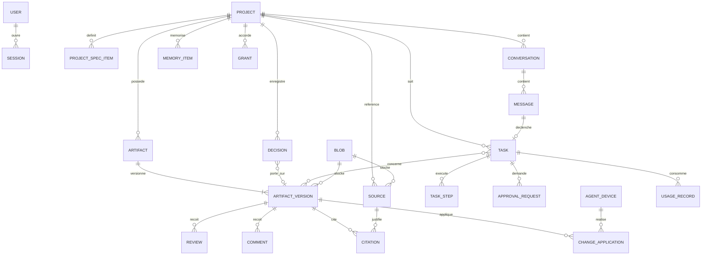
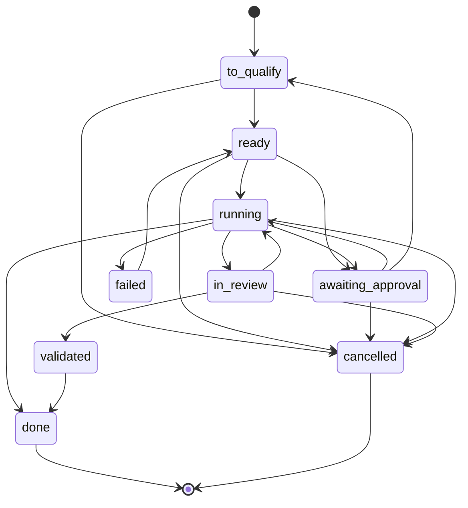
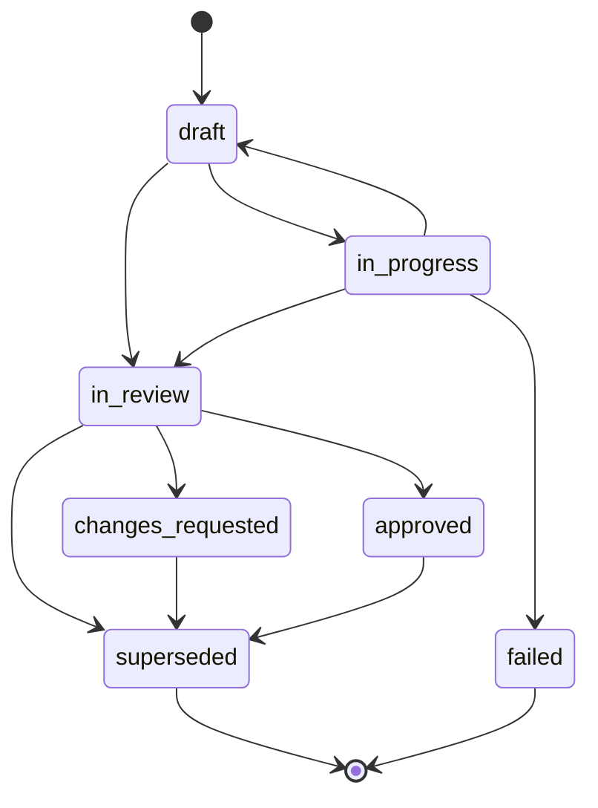

# 04 — Modèle de données conceptuel

Statut : validé le 2026-10-09

Ce document est la **référence du vocabulaire**. Les valeurs énumérées ci-dessous sont reprises telles quelles dans l'API, le protocole de l'agent et le Studio. Les identifiants techniques sont en anglais ; leur libellé d'interface est traduit.

## 1. Vocabulaire canonique

### États d'une tâche

<!-- enum:task_state -->
`to_qualify`, `ready`, `awaiting_approval`, `running`, `in_review`, `validated`, `done`, `cancelled`, `failed`

| Valeur | Libellé du cahier des charges |
| --- | --- |
| `to_qualify` | À qualifier |
| `ready` | Prête |
| `awaiting_approval` | En attente d'autorisation |
| `running` | En cours |
| `in_review` | À examiner |
| `validated` | Validée |
| `done` | Terminée |
| `cancelled` | Annulée |
| `failed` | Échec |

### États d'une version d'artefact

<!-- enum:version_state -->
`draft`, `in_progress`, `in_review`, `changes_requested`, `approved`, `superseded`, `failed`

| Valeur | Libellé du cahier des charges |
| --- | --- |
| `draft` | Brouillon |
| `in_progress` | En cours |
| `in_review` | À examiner |
| `changes_requested` | Modifications demandées |
| `approved` | Validé |
| `superseded` | Remplacé |
| `failed` | Échec |

### Autres énumérations

<!-- enum:artifact_type -->
Types d'artefact : `report`, `document`, `diagram`, `wireframe`, `mockup`, `image`, `scene3d`, `app_preview`, `change_set`, `test_run`

<!-- enum:content_format -->
Formats de contenu : `markdown`, `analysis.v1`, `mermaid`, `html`, `scene3d.v1`, `changeset.v1`, `testrun.v1`, `binary`

<!-- enum:permission_class -->
Classes de permission : `A`, `B`, `C`, `D`

<!-- enum:approval_status -->
Statuts d'une demande d'approbation : `pending`, `approved`, `denied`, `expired`, `consumed`

<!-- enum:memory_kind -->
Catégories de mémoire : `user_info`, `source_fact`, `nova_hypothesis`

<!-- enum:decision_status -->
Statuts d'une décision : `proposed`, `confirmed`, `rejected`, `revoked`, `superseded`

<!-- enum:review_decision -->
Décisions de validation : `approve`, `request_changes`

<!-- enum:llm_privacy -->
Confidentialité IA d'un projet : `local_only`, `cloud_allowed`

<!-- enum:web_access -->
Accès Web d'un projet : `enabled`, `disabled`

<!-- enum:capability_status -->
Statuts d'une capacité : `available`, `degraded`, `unavailable`, `not_implemented`

<!-- enum:agent_status -->
Statuts d'un agent : `online`, `offline`, `revoked`

<!-- enum:citation_status -->
Statuts d'une citation : `verified`, `unverified`

## 2. Diagramme entités–relations

`AUDIT_EVENT`, `EVENT_LOG` et `PAIRING_CODE` ne figurent pas sur le diagramme : ils référencent d'autres entités par identifiant, sans contrainte d'intégrité, pour survivre aux suppressions.

## 3. Entités

<!-- enum:entity -->
Entités : `USER`, `SESSION`, `AGENT_DEVICE`, `PAIRING_CODE`, `PROJECT`, `PROJECT_SPEC_ITEM`, `CONVERSATION`, `MESSAGE`, `MEMORY_ITEM`, `DECISION`, `SOURCE`, `CITATION`, `ARTIFACT`, `ARTIFACT_VERSION`, `REVIEW`, `COMMENT`, `TASK`, `TASK_STEP`, `APPROVAL_REQUEST`, `GRANT`, `CHANGE_APPLICATION`, `AUDIT_EVENT`, `USAGE_RECORD`, `BLOB`, `EVENT_LOG`

Toutes les entités ont un identifiant stable (UUID) et une date de création. Seuls les champs structurants sont listés.

| Entité | Module | Champs structurants |
| --- | --- | --- |
| `USER` | `identity` | nom, empreinte du mot de passe (Argon2id) |
| `SESSION` | `identity` | empreinte du jeton, secret CSRF, expiration |
| `AGENT_DEVICE` | `agent_gateway` | nom, clé publique, appairé ou révoqué, dernière connexion, capacités annoncées |
| `PAIRING_CODE` | `agent_gateway` | empreinte du code, expiration, date d'utilisation |
| `PROJECT` | `projects` | nom, description, `llm_privacy`, `web_access`, actif ou archivé, indicateur « espace libre » |
| `PROJECT_SPEC_ITEM` | `projects` | nature (`objective`, `requirement`, `constraint`), texte, origine (`user`, `nova`), confirmé ou non |
| `CONVERSATION` | `conversations` | projet, titre, posture courante |
| `MESSAGE` | `conversations` | conversation, numéro d'ordre, rôle, blocs de contenu, statut, fournisseur, modèle, raison du routage, charge utile brute du fournisseur, modalité d'entrée |
| `MEMORY_ITEM` | `memory` | projet (ou portée globale), catégorie, contenu, origine, source liée (obligatoire pour `source_fact`), épinglé, actif ou archivé |
| `DECISION` | `memory` | projet, intitulé, énoncé, justification, statut, proposée par, version d'artefact liée, date de confirmation, décision remplacée |
| `SOURCE` | `research` | projet, URL demandée et finale, titre, date de récupération, statut (`fetched`, `snippet_only`, `failed`), raison d'échec, empreinte, instantané, requête d'origine |
| `CITATION` | `research` | version d'artefact, source, repère, extrait, statut |
| `ARTIFACT` | `artifacts` | projet, type, titre, version courante, version approuvée |
| `ARTIFACT_VERSION` | `artifacts` | artefact, numéro, état, format de contenu, contenu ou fichier, empreinte du contenu, auteur (`user`, `nova`), version parente, version restaurée, résumé du changement |
| `REVIEW` | `artifacts` | version, empreinte du contenu au moment de la décision, décision, commentaire, date |
| `COMMENT` | `artifacts` | version, auteur, texte, ancre facultative, ouvert ou résolu |
| `TASK` | `tasks` | projet, message d'origine, nature, état, examen requis ou non, demande initiale, références de contexte, plan, erreur, effets irréversibles, tâche parente |
| `TASK_STEP` | `tasks` | tâche, numéro d'ordre, outil ou action, classe de permission, demande d'approbation liée, statut, exécutant, résumés d'entrée et de résultat, réversibilité, effets |
| `APPROVAL_REQUEST` | `permissions` | tâche, étape, classe, action canonique, empreinte de l'action, éléments concernés, conséquences, risques, retour arrière, statut, expiration, dates de décision et de consommation |
| `GRANT` | `permissions` | projet, type d'action, portée, date de révocation |
| `CHANGE_APPLICATION` | `devflow` | version du change set, agent, tâche, référence git de base, point de reprise, statut (`applied`, `partially_applied`, `failed`, `rolled_back`), effets |
| `AUDIT_EVENT` | `audit` | numéro d'ordre, date, acteur, action, classe, ressource résumée, décision, demande liée, tâche, issue |
| `USAGE_RECORD` | `providers` | fournisseur, modèle, tâche, message, jetons en entrée et en sortie, coût estimé, durée, issue |
| `BLOB` | `storage` | empreinte SHA-256 (sert d'identifiant), taille, type de média, nombre de références |
| `EVENT_LOG` | `events` | numéro d'ordre, type, projet, charge utile |

### Format de contenu par type d'artefact

| Type | Format | Contenu |
| --- | --- | --- |
| `report` | `markdown` | Texte, citations liées, section « limites » |
| `document` | `markdown` ou `analysis.v1` | Texte libre, ou analyse structurée dont chaque affirmation porte une étiquette `verified_fact`, `estimate` ou `assumption` |
| `diagram` | `mermaid` | Source du diagramme |
| `wireframe`, `mockup`, `app_preview` | `html` | Un document HTML autonome ; pour une maquette, une spécification de design jointe (jetons, composants, écrans) |
| `image` | `binary` | Fichier image, avec sa provenance (importée ou générée, et par quel fournisseur) |
| `scene3d` | `scene3d.v1` | Description de scène : primitives, matériaux, lumières, caméra, paramètres modifiables |
| `change_set` | `changeset.v1` | Référence git de base ; par fichier : opération, empreinte attendue avant modification, contenu après, diff unifié |
| `test_run` | `testrun.v1` | Identifiant de commande, arguments réellement exécutés, code de sortie, durée, sortie, résumé chiffré s'il a pu être extrait (sinon vide) |

## 4. Machines à états

### 4.1 Tâche

| Transition | Déclencheur |
| --- | --- |
| `awaiting_approval` → `running` | L'utilisateur approuve |
| `awaiting_approval` → `to_qualify` | Refus ou expiration : le plan doit être revu |
| `running` → `done` | Uniquement si la tâche ne requiert pas d'examen (un tour de conversation, par exemple) |
| `in_review` → `running` | L'utilisateur demande des modifications |
| `failed` → `ready` | Relance explicite par l'utilisateur |

### 4.2 Version d'artefact

| Règle | Énoncé |
| --- | --- |
| Modification | Le contenu n'est modifiable qu'en `draft` et `in_progress`. Au-delà, toute modification crée la version suivante |
| Remplacement d'une version non approuvée | Une version `in_review` ou `changes_requested` passe à `superseded` quand la version suivante entre en `in_review` |
| Remplacement d'une version approuvée | Une version `approved` reste la référence jusqu'à ce qu'une version ultérieure soit approuvée ; elle passe alors à `superseded` |
| Restauration | Restaurer la version *k* crée une nouvelle version, copie de *k*, à l'état `in_review`. Rien n'est écrasé |

## 5. Invariants

Chacun est vérifié par au moins un test automatisé.

| # | Invariant |
| --- | --- |
| INV-1 | Un artefact a au plus une version `approved`. |
| INV-2 | Le contenu et l'empreinte d'une version sont figés dès qu'elle quitte `draft` et `in_progress`. |
| INV-3 | Une validation référence une seule version et l'empreinte de son contenu. Elle ne peut être créée que par une requête authentifiée de l'utilisateur. |
| INV-4 | Une décision n'atteint le statut `confirmed` que par une requête authentifiée de l'utilisateur. |
| INV-5 | Un artefact `test_run` n'est créé que par le système, à partir d'un résultat renvoyé par l'agent. |
| INV-6 | Une citation n'est `verified` que si son extrait figure mot pour mot dans l'instantané de sa source. |
| INV-7 | Une approbation est liée à l'empreinte d'une action et ne sert qu'une fois. |
| INV-8 | Le journal d'audit est en ajout seul : aucune route ni aucun service ne modifie ou ne supprime un événement. |
| INV-9 | Les messages d'une conversation sont en ajout seul. |
| INV-10 | Aucun appel à un fournisseur cloud n'est émis pour un projet `local_only` ni pour un message marqué « local uniquement ». |
| INV-11 | L'état d'une tâche et celui d'une version ne changent que selon les transitions du §4. |
| INV-12 | Toute conversation, tout artefact, toute tâche appartient à exactement un projet. |
| INV-13 | Un élément de mémoire `source_fact` référence une source existante. |
| INV-14 | Un change set ne peut être appliqué que si sa version est `approved`. |

## 6. Conversations sans projet

Toute conversation appartient à un projet (INV-12). Un projet « espace libre », créé à l'installation, accueille les discussions qui n'en ont pas encore. Une conversation peut être déplacée vers un autre projet.

## 7. Suppression et conservation

| Suppression de | Effet |
| --- | --- |
| Projet | Supprime conversations, messages, mémoire, décisions, sources, artefacts, versions, validations, commentaires, tâches, approbations, autorisations permanentes |
| Conversation | Supprime ses messages ; les artefacts créés restent dans le projet |
| Artefact | Supprime ses versions, validations, commentaires et citations |
| Élément de mémoire, décision | Suppression immédiate |
| Fichier stocké | Supprimé du disque quand plus aucune version ni source ne le référence |

- Le journal d'audit conserve la trace de la suppression (qui, quoi, quand) sans contenu.
- Un projet peut être exporté en archive avant suppression.
- Limite à afficher à l'utilisateur : NOVA ne peut pas effacer ce qui a déjà été transmis à un fournisseur cloud ; cela relève de la politique de conservation de ce fournisseur.

## 8. Portabilité SQLite et PostgreSQL

- Types génériques uniquement : texte, entier, booléen, horodatage UTC, JSON.
- Aucune fonction propre à un moteur dans les requêtes du MVP.
- Les migrations Alembic sont la seule voie de modification du schéma.
- La suite de tests s'exécute sur SQLite. Son exécution sur PostgreSQL est prévue avant toute mise en hébergement, pas au MVP.
