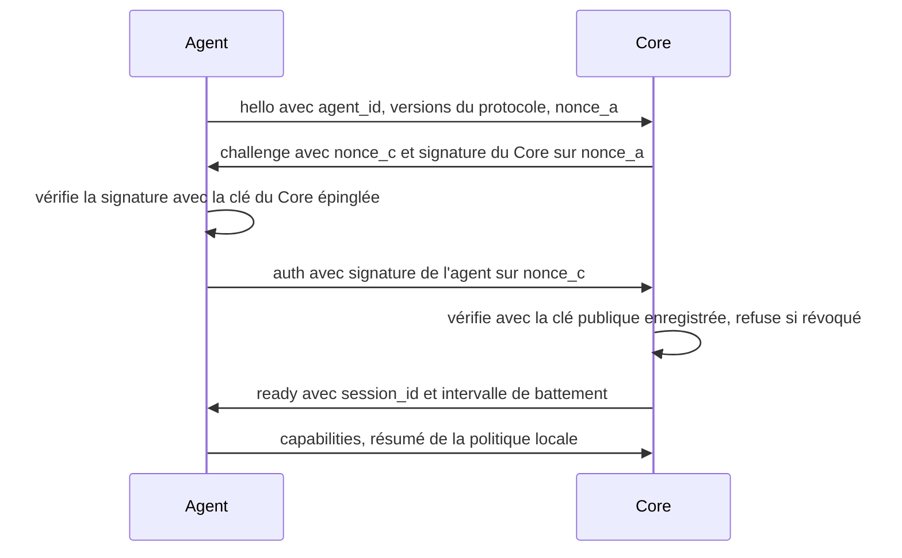

# 06 — Protocole de communication de l'agent local

Statut : validé le 2026-10-09

## 1. Objectifs de sécurité

| # | Objectif | Moyen |
| --- | --- | --- |
| S1 | Aucun port local exposé | L'agent ouvre une connexion sortante vers le Core ; il n'écoute nulle part |
| S2 | Communications authentifiées | Authentification mutuelle par signature Ed25519 à chaque connexion |
| S3 | Chemins confinés | Tout chemin est résolu puis comparé aux répertoires autorisés par la politique locale |
| S4 | Aucune instruction du modèle dans une ligne de commande | Le Core désigne une commande par son identifiant ; l'agent construit lui-même la liste d'arguments à partir de son gabarit local |
| S5 | Opérations destructrices bloquées ou confirmées | Refus par défaut ; les rares opérations admises exigent une approbation liée à l'action exacte |
| S6 | Permissions propres à l'agent | La politique est un fichier local que ni le Core ni le modèle ne peuvent modifier |
| S7 | Arrêt et révocation | Commandes locales `stop` et `revoke` ; arrêt et révocation depuis le Studio |

Le protocole suppose que le Core peut se tromper. L'agent revérifie tout ce qu'il reçoit.

## 2. Transport

- WebSocket ouvert par l'agent vers `/agent/v1/ws`.
- `wss://` obligatoire. Seule exception : `ws://` vers une adresse de bouclage, pour le mode local. L'agent refuse toute autre URL en clair.
- Messages JSON, un par trame. Taille maximale par trame : 1 Mo ; les contenus plus volumineux sont découpés.
- Battement de cœur toutes les 20 secondes ; sans réponse après 60 secondes, la connexion est considérée perdue. L'agent se reconnecte avec une attente croissante.

## 3. Appairage

Une seule fois par agent.

1. Dans le Studio, l'utilisateur demande un code d'appairage. Le Core en crée un, valable 10 minutes et utilisable une fois ; il n'en conserve que l'empreinte.
2. L'utilisateur lance `nova-agent pair --core-url <url> --code <code>`.
3. L'agent génère une paire de clés Ed25519. La clé privée reste sur le poste, dans le magasin d'identifiants du système.
4. L'agent envoie le code et sa clé publique à `POST /api/v1/agents/pair`.
5. Le Core enregistre la clé publique et répond avec l'identifiant de l'agent et sa propre clé publique, que l'agent épingle.

À partir de là, chaque partie peut prouver son identité à l'autre sans secret partagé. Une fuite de la base du Core ne révèle aucune clé privée.

## 4. Ouverture de session



- Les nonces font 32 octets aléatoires et ne servent qu'une fois. Chaque signature couvre le nonce, l'identifiant de l'agent et la version du protocole.
- Si une vérification échoue, la connexion est fermée sans détail.
- Le message `capabilities` annonce les alias des répertoires autorisés, les identifiants de commandes disponibles et les limites. Il informe le Core et le Studio ; il n'accorde rien.

## 5. Enveloppe

```json
{
  "v": 1,
  "type": "command",
  "id": "9b0c…",
  "ts": "2026-10-09T14:05:00Z",
  "payload": { }
}
```

| Type | Sens | Rôle |
| --- | --- | --- |
| `hello`, `auth`, `capabilities` | Agent → Core | Ouverture de session |
| `challenge`, `ready` | Core → Agent | Ouverture de session |
| `ping`, `pong` | Les deux | Battement de cœur |
| `command` | Core → Agent | Demande d'exécution |
| `command.accepted` | Agent → Core | La commande a passé les contrôles locaux et démarre |
| `command.rejected` | Agent → Core | Refus local, avec un code |
| `command.output` | Agent → Core | Fragment de sortie d'un processus |
| `command.result` | Agent → Core | Résultat final et effets |
| `command.cancel` | Core → Agent | Demande d'annulation |
| `shutdown` | Core → Agent | Arrêt propre demandé depuis le Studio |
| `revoked` | Core → Agent | L'accès est révoqué ; l'agent efface sa session et s'arrête |

## 6. Commandes

```json
{
  "command_id": "…",
  "task_id": "…",
  "action": "cmd.run",
  "params": { "root": "demo-app", "command": "test.pytest", "args": { "target": "tests/" } },
  "approval": null,
  "issued_at": "2026-10-09T14:05:00Z",
  "expires_at": "2026-10-09T14:06:00Z"
}
```

Pour une action soumise à confirmation, `approval` porte `{ "approval_id": "…", "action_hash": "sha256:…" }`.

### 6.1 Actions du MVP

<!-- enum:agent_action -->
Actions : `fs.list`, `fs.read`, `fs.search`, `fs.write`, `fs.apply_patch`, `fs.delete`, `cmd.run`, `git.status`, `git.diff`, `git.log`, `git.checkpoint`, `git.commit`, `git.restore_checkpoint`

| Action | Paramètres | Résultat | Classe |
| --- | --- | --- | --- |
| `fs.list` | `root`, `path`, profondeur | Entrées, tailles, types | A |
| `fs.read` | `root`, `path`, plage facultative | Contenu, empreinte, indicateur de troncature | A |
| `fs.search` | `root`, motif, filtre de fichiers | Correspondances avec fichier et ligne | A |
| `fs.write` | `root`, `path` dans l'espace dédié, contenu | Empreinte du fichier créé | B |
| `fs.apply_patch` | `root`, opérations par fichier avec empreinte attendue avant modification | Fichiers modifiés, point de reprise | C |
| `fs.delete` | `root`, `path` | Fichier supprimé | C |
| `cmd.run` | `root`, `command` (identifiant), `args` (valeurs nommées) | Code de sortie, durée, sortie | B ; C si la commande est déclarée `sensitive` |
| `git.status`, `git.diff`, `git.log` | `root`, options bornées | Sortie structurée | A |
| `git.checkpoint` | `root`, libellé | Référence du point de reprise | B |
| `git.commit` | `root`, message, fichiers | Référence du commit, sur une branche `nova/…` | B |
| `git.restore_checkpoint` | `root`, référence | Fichiers restaurés | C |

La classe indiquée est celle que l'agent applique. Elle coïncide avec la matrice du document [07](07-permissions.md).

### 6.2 Codes de refus

| Code | Signification |
| --- | --- |
| `UNKNOWN_ACTION` | Action absente du protocole |
| `UNKNOWN_ROOT` | Alias de répertoire inconnu de la politique locale |
| `PATH_OUTSIDE_ROOTS` | Le chemin résolu sort des répertoires autorisés |
| `PATH_DENIED` | Le chemin correspond à un motif interdit |
| `UNKNOWN_COMMAND` | Identifiant de commande absent de la politique locale |
| `INVALID_ARGUMENT` | Un argument ne respecte pas le motif déclaré |
| `POLICY_DENIED` | Action désactivée par la politique locale |
| `APPROVAL_REQUIRED` | Action de classe C reçue sans approbation |
| `APPROVAL_MISMATCH` | L'empreinte reçue ne correspond pas à l'action reçue |
| `PRECONDITION_FAILED` | Un fichier a changé depuis la préparation du change set |
| `EXPIRED` | Commande reçue après son échéance |
| `DUPLICATE` | Identifiant de commande déjà traité |
| `BUSY` | Trop de commandes en cours |

Un refus est toujours rapporté tel quel à l'utilisateur. Le Core ne retente pas une commande refusée.

## 7. Empreinte d'action

`action_hash` est le SHA-256 de la forme canonique de `{ "action": …, "params": … }` : clés triées, UTF-8, sans espace superflu. La fonction est fournie par le paquet partagé `nova_protocol`, utilisée à l'identique par le Core et l'agent, et couverte par des cas de test communs.

L'agent recalcule l'empreinte de la commande qu'il s'apprête à exécuter et la compare à celle de l'approbation. Une approbation ne peut donc pas servir à une autre action, ni à la même action avec d'autres paramètres.

## 8. Validation des chemins

Appliquée à chaque chemin de chaque commande, dans cet ordre :

1. Refuser les chemins absolus, les chemins UNC, les préfixes de périphérique, les noms de périphériques réservés de Windows et les flux de données alternatifs.
2. Joindre le chemin relatif au répertoire désigné par l'alias `root`.
3. Résoudre le chemin réel, liens symboliques et jonctions compris.
4. Vérifier que le chemin résolu est le répertoire autorisé ou l'un de ses descendants, avec une comparaison adaptée au système de fichiers (insensible à la casse sous Windows).
5. Vérifier qu'il ne correspond à aucun motif interdit.
6. Pour une écriture, refaire les étapes 3 et 4 sur le répertoire parent juste avant d'écrire.

## 9. Exécution des commandes

- **Jamais d'interpréteur de commandes.** Les processus sont lancés avec une liste d'arguments.
- **Gabarits locaux.** Chaque identifiant de commande correspond, dans la politique locale, à un exécutable, une liste d'arguments fixes et des emplacements nommés. Chaque emplacement a un motif de validation et devient un argument distinct.
- **Environnement réduit.** Seules les variables listées dans la politique sont transmises.
- **Bornes.** Durée maximale et volume de sortie maximal par commande ; au-delà, le processus est arrêté et le résultat le signale.
- **Arbre de processus.** L'arrêt, sur annulation ou dépassement, vise le processus et tous ses descendants.
- **Répertoire de travail.** Toujours à l'intérieur du répertoire autorisé.

Limite assumée : une commande de test exécute le code du projet avec les droits de l'utilisateur. Le MVP ne l'isole pas dans un conteneur. C'est pourquoi seules des commandes prédéfinies, dans des répertoires approuvés, sont possibles par défaut.

## 10. Politique locale

Fichier `policy.toml` dans le répertoire de configuration de l'agent. Lu au démarrage ; une modification exige un redémarrage. Exemple :

```toml
[roots.demo-app]
path = "C:/Users/exp/nova-projects/demo-app"
workspace = ".nova/workspace"
write_project_files = true

[deny]
patterns = ["**/.env", "**/.env.*", "**/*.pem", "**/*.key", "**/id_rsa*", "**/.git/config", "**/.ssh/**"]

[commands."test.pytest"]
executable = "python"
args = ["-m", "pytest", "{target}", "-q"]
timeout_seconds = 300
max_output_bytes = 1048576

[commands."test.pytest".params.target]
pattern = "^[A-Za-z0-9_./-]{1,200}$"

[commands."deps.sync"]
executable = "uv"
args = ["sync"]
timeout_seconds = 600
max_output_bytes = 1048576
sensitive = true

[git]
enabled = true
branch_prefix = "nova/"

[safety]
allow_arbitrary_commands = false
confirm_class_c_locally = false
env_allowlist = ["PATH", "SYSTEMROOT", "TEMP", "TMP"]
```

| Réglage | Effet |
| --- | --- |
| `write_project_files = false` | `fs.apply_patch` et `fs.delete` sont refusés hors de l'espace dédié |
| `sensitive = true` sur une commande | La commande passe en classe C : approbation de chaque exécution. À utiliser pour toute installation de dépendances |
| `allow_arbitrary_commands = false` | Toute commande sans identifiant déclaré est refusée. Valeur par défaut, et seule valeur prise en charge au MVP |
| `confirm_class_c_locally = true` | Durcissement facultatif : l'agent demande en plus une confirmation dans son propre terminal |

## 11. Opérations git

- Autorisées : état, diff, journal, création d'un point de reprise, commit sur une branche préfixée `nova/`, restauration d'un point de reprise créé par NOVA.
- Refusées au MVP, quel que soit le demandeur : `push`, `reset --hard`, `clean`, `rebase`, suppression de branche, toute option de forçage, toute modification de la configuration git.
- `git.checkpoint` refuse d'agir si le répertoire contient des modifications non enregistrées qu'il ne peut pas préserver ; il le signale au lieu de les écraser.

## 12. Annulation

`command.cancel` arrête le processus en cours. Le `command.result` qui suit porte le statut `cancelled` et la liste des effets déjà produits (fichiers écrits, par exemple). Pour une commande externe interrompue, l'agent indique que ses effets éventuels ne sont pas connus.

## 13. Arrêt et révocation

| Geste | Effet |
| --- | --- |
| `nova-agent stop` | Arrête l'agent ; les commandes en cours sont annulées |
| `nova-agent revoke` | Efface la clé privée locale ; un nouvel appairage est nécessaire |
| Studio → « Arrêter l'agent » | Envoie `shutdown` |
| Studio → « Révoquer » | Le Core marque l'agent comme révoqué, envoie `revoked` et refuse toute reconnexion |

L'utilisateur garde toujours un moyen d'arrêter l'agent sans passer par le Core.

<!-- enum:agent_status -->
Statuts vus par le Core : `online`, `offline`, `revoked`

## 14. Journal d'activité local

L'agent tient son propre journal, en ajout seul : commande reçue, décision locale, code de refus le cas échéant, durée, code de sortie, effets. Ce journal est indépendant du journal d'audit du Core et permet de les comparer.

## 15. Évolution du protocole

Le champ `v` porte la version majeure. À l'ouverture, l'agent annonce les versions qu'il comprend et le Core choisit la plus haute commune. Faute de version commune, la connexion est refusée avec un message explicite. Un message de type inconnu est ignoré et journalisé.

## 16. Tests prévus

| Cible | Vérification |
| --- | --- |
| Appairage et session | Code expiré ou réutilisé refusé ; signature invalide refusée ; agent révoqué refusé |
| Chemins | Remontée par `..`, lien symbolique et jonction sortants, chemin absolu, UNC, casse, motif interdit |
| Commandes | Identifiant inconnu, argument hors motif, tentative d'injection dans un argument, dépassement de durée, annulation avec arrêt des processus enfants |
| Approbations | Classe C sans approbation ; empreinte ne correspondant pas ; approbation rejouée |
| Change set | Fichier modifié depuis la préparation ; point de reprise puis restauration à l'identique |
| Compatibilité | Cas de test du protocole partagés, exécutés côté Core et côté agent |
